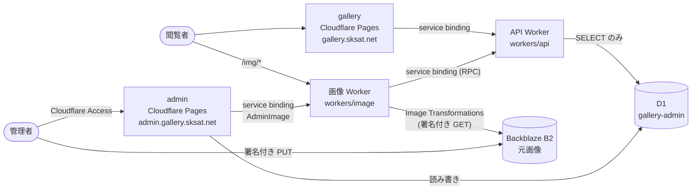

# gallery.sksat.net

sksat の写真ギャラリー <https://gallery.sksat.net> のソースです。
実世界で撮った写真、フィルムなどをスキャンした写真、VRChat のスクリーンショットを載せています。
公開しているサイト (gallery) と、写真をアップロードして管理する管理画面 (admin) を、どちらも Cloudflare 上で動かしています。

主な機能:

- タグ (AND / OR) で絞り込める一覧と、写真ごとのページ (`/photo/<公開 ID>/`)
- カレンダー (`/calendar/`)、地図 (`/map/`)、カメラごとのページ (`/camera/`)
- 写真ごとの公開状態 (公開 / 限定公開 / 非公開) と、メタデータの項目ごとの公開範囲 (撮影日時は日まで、位置は市区町村くらいまで、など)
- 配信する画像には、公開しているメタデータだけを EXIF として埋め込みます
- 写真のアップロードは、管理者のブラウザから Backblaze B2 へ直接送ります (admin は署名付き URL を発行するだけです)

## 構成



- **gallery** (`src/`): Qwik City の SSR アプリです。route loader が API Worker から写真とカメラの一覧を読みます。
- **API Worker** (`workers/api/`): D1 を読むだけの JSON API (`/api/*`) です。どの写真のどのメタデータを公開するかは、すべてここで決めます。
- **画像 Worker** (`workers/image/`): `/img/<公開 ID>?size=<preset>` で縮小した画像を返します。リサイズは Cloudflare Image Transformations が行い、Worker は公開範囲の確認、EXIF の埋め込み、エッジキャッシュを受け持ちます。
- **admin** (`admin/`): 写真の管理画面です。別の Qwik City プロジェクトで、D1 のスキーマ (`admin/migrations/`) も持っています。D1 に書き込むのは admin だけです。
- **shared** (`shared/`): gallery と admin の両方で使うコード (カレンダーの集計、地図、写真のオーバーレイなど) です。

Worker の作成とルート (`gallery.sksat.net/api/*`、`/img/*`) は、このリポジトリの外の Terraform で管理しています。
このリポジトリからは Worker のコードをデプロイするだけなので、`wrangler.jsonc` に `routes` は書きません。

### 設計上の制約

- **無料枠に収める**:
  - D1 は Free プランで 1 日 500 万行までしか読めません。そこで API Worker は答えを Cache API でエッジにキャッシュします。D1 が失敗したとき (上限に達したときなど) は、最後に読めた答えを最大 2 日分残してあるので、それを返します。
  - Workers は 1 リクエストあたり CPU 10 ms までなので、8K の PNG などのリサイズは Worker の中で行わず、Image Transformations に任せます。
  - Image Transformations の無料枠は、月 5,000 件のユニークな変換 (画像とサイズの組) です。そのため、サイズの preset は `workers/image/src/request.ts` にあるものだけを使い、画面や部品ごとに増やしません。
- **プライバシー**: 非公開の写真には外から届きません。元画像は非公開の B2 バケットにあり、画像 Worker だけが署名付き URL で読みます。非公開の写真は API にも画像 Worker の `/img/*` にも出てきません (どちらも 404)。限定公開の写真はその写真のページ (`/photo/<公開 ID>/`) でだけ開け、一覧には出ません。メタデータの公開範囲は API Worker の `projectPhoto` (`workers/api/src/query.ts`) の一か所で決めていて、画像に埋め込む EXIF もその結果から作ります。非公開の写真も出す admin のサムネイルは、`/img/*` とは別の入口 (`AdminImage`) から出します。この入口は admin の service binding からしか呼べず、さらに画像 Worker 自身が Cloudflare Access の JWT を検証します。

細かい仕様は [CLAUDE.md](CLAUDE.md) と [admin/CLAUDE.md](admin/CLAUDE.md) にまとめています。

## ディレクトリ構成

| ディレクトリ | 内容                                                                |
| ------------ | ------------------------------------------------------------------- |
| `src/`       | gallery の Qwik City アプリ                                         |
| `public/`    | gallery の静的ファイル (テスト用の画像 `public/test-media/` を含む) |
| `adapters/`  | gallery の Cloudflare Pages 用ビルド設定                            |
| `e2e/`       | gallery の E2E と VRT (Playwright)                                  |
| `shared/`    | gallery と admin で共有するコード (`@shared/*`)                     |
| `workers/`   | API Worker (`api/`) と画像 Worker (`image/`)                        |
| `admin/`     | admin の Qwik City アプリ (独自の `package.json` と D1 のスキーマ)  |
| `media/`     | 開発時に元画像を置く場所 (中身はコミットしません)                   |
| `.github/`   | CI と Worker のデプロイ (GitHub Actions)                            |

## 開発

### 必要なもの

- Node.js 20.19.0 以上 (CI は `.node-version` のバージョンを使います)
- pnpm 12 (`package.json` の `packageManager` で固定しています。手元の pnpm のメジャーバージョンが違うときは `npx -y pnpm@12.21.0` で実行してください)

ルートと `admin/` は別々の pnpm プロジェクトなので、それぞれで `pnpm install` します。

### gallery

```bash
pnpm install
pnpm dev     # http://localhost:5173
```

`.env.local` の設定では、写真の一覧は本番の API (公開データだけ) から読み、画像は手元の `media/` からバケットと同じパスで読みます。
`media/` に元画像を置いていなければ、画像は表示されません。

### admin

```bash
cd admin
pnpm install
cp .dev.vars.example .dev.vars   # ローカルでは Access の JWT 検証を外す
pnpm db.migrate.local            # ローカルの D1 にスキーマを作る
pnpm run build && pnpm serve     # D1 が使える wrangler pages dev
```

`pnpm dev` (http://localhost:5175) でも起動しますが、D1 につながらないので写真の画面は動きません。
詳しくは [admin/CLAUDE.md](admin/CLAUDE.md) と [admin/README.md](admin/README.md) を見てください。

### テスト

```bash
pnpm test              # Vitest (watch モード。shared/ と workers/ のテストも含む)
pnpm run test.e2e      # Playwright の E2E
pnpm run test.vrt      # Playwright の VRT (スクリーンショットの比較)
pnpm run build.types   # 型チェック
pnpm lint
pnpm run fmt.check
```

admin でも `pnpm test`、`pnpm run test.e2e`、`pnpm run test.vrt` が使えます。
E2E と VRT は、ローカルの D1 にテスト用のデータを入れた API Worker と、`public/test-media/` の画像を使います。本番の API や B2 には接続しません。
VRT のベースライン画像はフォントの違いで変わるので、CI と同じ Playwright の Docker イメージの中で作り直します。コマンドは [CLAUDE.md の VRT baselines](CLAUDE.md#vrt-baselines) にあります。

### デプロイ

- **gallery と admin**: Cloudflare Pages の Git 連携で、`main` へのマージで本番に、PR でプレビューにデプロイされます。admin は `admin/` か `shared/` が変わったときだけビルドします。
- **API Worker と画像 Worker**: `main` へのマージでその Worker のファイルが変わっていれば、GitHub Actions (`.github/workflows/deploy-*-worker.yaml`) がデプロイします。手動なら `pnpm run deploy.api` / `pnpm run deploy.image` です。
- **D1 のマイグレーション**: `admin/migrations/` に追加し、本番への適用 (`admin/` で `pnpm db.migrate.remote`) は管理者が手で行います。admin や API Worker は `main` へのマージで自動的にデプロイされるので、新しい列を使う変更は、マイグレーションを本番に適用してからマージします。

## ライセンス

[](LICENSE)

イラストとアイコンの画像 (`src/media/` と、それを使った画像) は対象外です。
