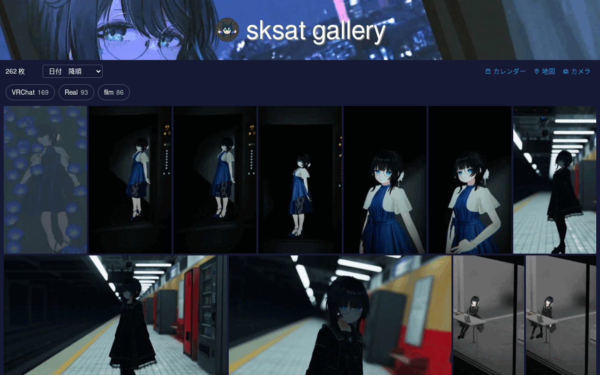
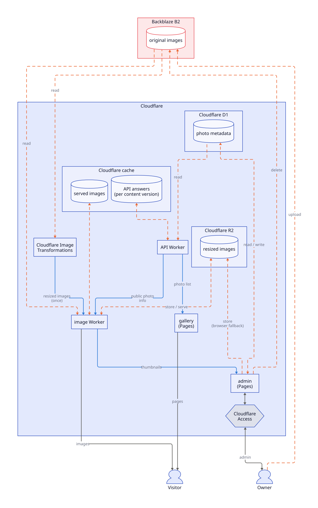

# gallery.sksat.net

[](https://github.com/sksat/gallery.sksat.net/actions/workflows/ci.yaml)
[](https://github.com/sksat/gallery.sksat.net/actions/workflows/deploy-api-worker.yaml)
[](https://github.com/sksat/gallery.sksat.net/actions/workflows/deploy-image-worker.yaml)
[](LICENSE)

[gallery.sksat.net](https://gallery.sksat.net) is sksat's photo gallery.



It shows photos taken in the real world, scanned from film and other analog originals, and taken in VRChat.
Photos can be filtered by tag and browsed by calendar, map and camera.
Each photo is public, unlisted or private, and how much of its metadata (time taken, place, camera, …) is public is chosen per field.

## Architecture



Arrows point the way the data moves: grey for HTTP with people, blue for calls between services (service bindings, RPC), dashed orange for stored data.

- **gallery** (`src/`): the public site, a Qwik City app on Cloudflare Pages. It reads the photo list from the API Worker.
- **API Worker** (`workers/api/`): a read-only JSON API over Cloudflare D1. It decides which photos and which of their metadata are public.
- **image Worker** (`workers/image/`): serves resized photos. Resized copies are made once with Cloudflare Image Transformations and kept in Cloudflare R2.
- **admin** (`admin/`): the admin app, behind Cloudflare Access. It owns the D1 schema (`admin/migrations/`), and the owner's browser uploads originals straight to Backblaze B2.
- **shared** (`shared/`): code used by both the gallery and the admin.

The diagram is drawn from [docs/architecture.d2](docs/architecture.d2) with [d2](https://d2lang.com).
The Workers, their routes and the R2 bucket are created by Terraform outside this repository.
Constraints such as Cloudflare's free-plan limits are in [CLAUDE.md](CLAUDE.md).

## Development

Node.js 20.19.0 or later and pnpm 12 (pinned by `packageManager`).
The root and `admin/` are separate pnpm projects: run `pnpm install` in each, and see each `package.json` for the scripts.

`pnpm dev` starts the gallery. It reads the photo list from the production API (public data only) and images from a local `media/`, so images do not show unless you have the originals there.

The admin needs D1, so run it with wrangler rather than `pnpm dev`:

```bash
cd admin
cp .dev.vars.example .dev.vars   # skips the Access JWT check locally
pnpm db.migrate.local            # creates the schema in the local D1
pnpm run build && pnpm serve
```

E2E and VRT use a local D1 and test images only, never production.
Regenerate VRT baselines in the same Playwright Docker image as CI ([CLAUDE.md](CLAUDE.md#vrt-baselines)).

## Deployment

- **gallery and admin**: Cloudflare Pages' Git integration deploys `main` to production and PRs to previews.
- **API Worker and image Worker**: GitHub Actions deploys them on a merge to `main`.
- **D1 migrations**: applied to production by hand. Apply a migration before merging a change that uses its columns.

## License

The code is under the [MIT License](LICENSE).
The illustration and icon images (`src/media/` and the images made from them) and the site screenshots (`docs/screenshot*.png`) are not.
